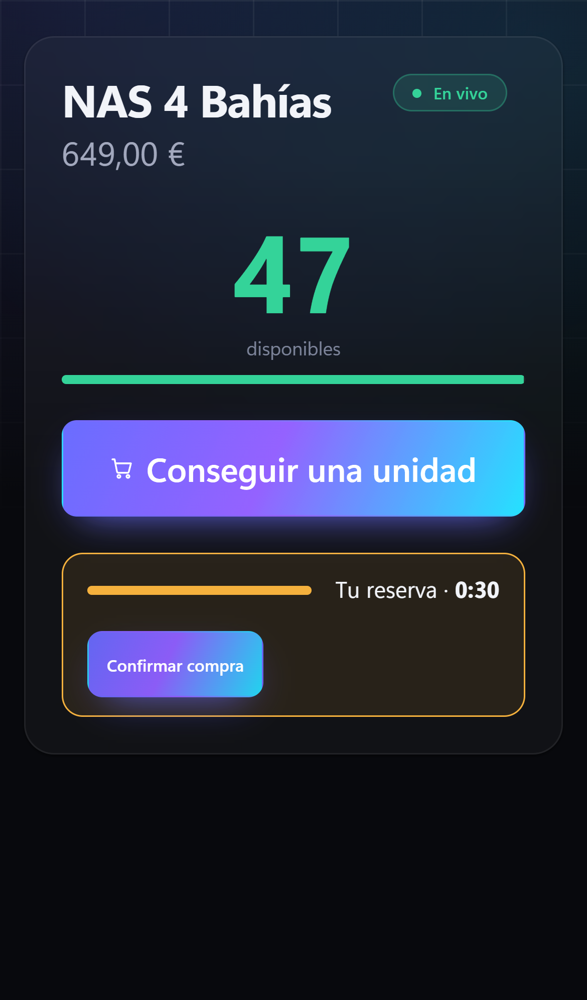
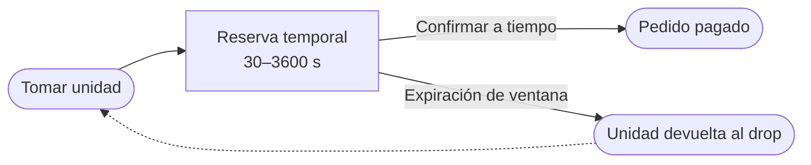
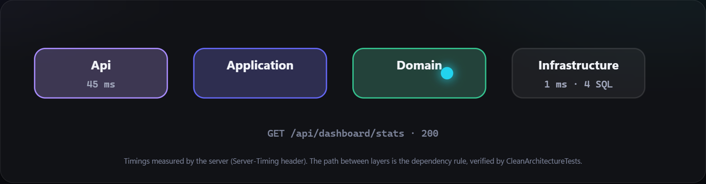
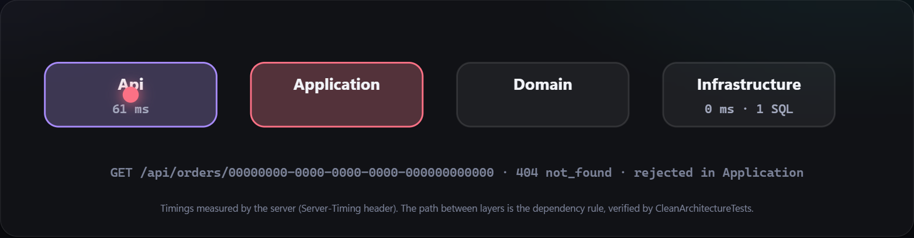

<picture>
  <source media="(prefers-color-scheme: dark)" srcset="docs/assets/banner-dark.svg">
  <source media="(prefers-color-scheme: light)" srcset="docs/assets/banner-light.svg">
  
</picture>

# NainOrder

**Vende un lanzamiento limitado (*drop*) a una multitud: exactamente N unidades, nunca sobrevendidas y sin inventario bloqueado en carritos abandonados.**

[](README.md)
[](#)
[](https://github.com/Nain9Dev/NainOrder/actions/workflows/ci.yml)
[](https://github.com/Nain9Dev/NainOrder/actions/workflows/codeql.yml)


[](https://order.naindev.com/)

<p align="center">
  
</p>

<p align="center">
  
</p>

> **48 unidades. 40 compradores liberados a la vez.** Cada unidad está *disponible*, *reservada temporalmente* por 30 segundos o *vendida*.
> Si se reserva pero no se confirma a tiempo: regresa a la multitud. Pruébalo como **comprador** o como **organizador**, en
> español o inglés: abre la aplicación y pulsa **Liberar 40 compradores**.

---

## Uso real: un lanzamiento pop-up en cinco minutos

El organizador inicia el lanzamiento en un portátil y proyecta un **código QR**. La audiencia lo escanea y accede a la página
de compra: un solo botón, una cuenta atrás y nada que instalar o registrar. Es instalable como PWA,
funciona en dispositivos móviles y notifica cuando no hay conexión.

<p align="center">
  
</p>

[Paso a paso, con el significado de cada garantía para el vendedor →](docs/case-study.md)

---

## El problema que resuelve

Los lanzamientos de edición limitada fallan habitualmente de la misma forma: una multitud masiva concurre en el mismo segundo y la tienda o bien **sobrevende** o bien **bloquea stock en carritos abandonados**. NainOrder es el motor determinista que previene ambos problemas.



| Garantía | Cómo se impone |
| :--- | :--- |
| Jamás hay más unidades reservadas + vendidas que el total del lote | Un único agregado con token de concurrencia optimista |
| Ningún comprador puede acaparar el lanzamiento | Límite estricto por comprador entre reservas y pedidos |
| Las reservas abandonadas se liberan solas | Expiración evaluada en cada lectura y barrido automático por segundo |
| Precisión monetaria exacta | Céntimos enteros en enteros sin coma flotante |

---

## Arquitectura en vivo

<p align="center">
  
</p>

<p align="center">
  
</p>

Cada petición del panel recorre las cuatro capas en pantalla de forma determinista: el servidor envía sus métricas (`Server-Timing`) y, en caso de rechazo, la **capa exacta que emitió el rechazo** (`layer` en la respuesta de error). Las reglas de dependencia se validan en tiempo de compilación con `NetArchTest`.

<details>
<summary>Las cuatro capas estáticas</summary>
<p align="center">
  
</p>
</details>

<p align="center">
  
  
</p>

El panel está compuesto por módulos ES puros servidos directamente por la API: sin npm, sin paso de compilación y sin CORS. Incluye además un simulador de **carrera de stock** en concurrencia real y la gestión completa de pedidos.

---

## Verificación determinista

| Requisito verificado | Prueba |
| :--- | :--- |
| La multitud jamás reserva ni compra más unidades que el lote | `DropFlowTests` (40 compradores concurrentes), `DropTests` (property-based) |
| Las reservas expiran sin esperas artificiales en tests | `DropTests`, `DropFlowTests` con reloj inyectado |
| El stock nunca se sobrevende en carreras de alta concurrencia | `StockRaceTests`, `ConcurrencyTests` |
| Dos actualizaciones concurrentes sobre el mismo pedido nunca provocan pérdida de datos | `OrderAggregateConcurrencyProbe` |
| El dominio tiene cero dependencias externas | `CleanArchitectureTests` |
| El código QR enlaza al comprador, la shell funciona sin conexión y el diseño móvil encaja | `e2e/` — 29 pruebas de navegador (Playwright) sobre la app real |
| El mapa de peticiones muestra métricas reales medidas, nunca estimadas | `RequestObservabilityTests`: `Server-Timing` y la propiedad `layer` en rechazos |
| El contenedor Docker se compila y ejecuta correctamente | Workflow de CI compila la imagen y valida sondas de salud |

Trazabilidad completa en [`docs/50-traceability.md`](docs/50-traceability.md).

---

## Inicio rápido

```bash
git clone https://github.com/Nain9Dev/NainOrder.git
cd NainOrder/NainOrder.Api && dotnet run
```

Abre <http://localhost:8170> → **Probar como comprador** o **Probar como organizador**. Disponibles también: [`/swagger`](http://localhost:8170/swagger) y `/health`. No requiere instalar base de datos externa: SQLite se auto-inicializa en modo WAL.

```bash
dotnet test NainOrder.slnx -c Release          # 130 pruebas
cd e2e && npm ci && npx playwright test        # 29 pruebas de navegador Playwright
docker build -t nainorder . && docker run -p 8080:8080 nainorder
```

> **Sobre la demostración en vivo.** [order.naindev.com](https://order.naindev.com/) es una página estática, por lo que el panel funciona mediante un motor en el navegador para ilustrar la mecánica. Las garantías de concurrencia multinúcleo se ejecutan contra la API de .NET en local o contenedor.

---

## Documentación detallada

[Charter](docs/00-charter.md) · [Requisitos](docs/10-requirements.md) · [Arquitectura](docs/20-architecture.md) ·
[Modelo de datos](docs/21-data-model.md) · [9 ADRs](docs/30-decisions/) · [Modelo de amenazas](docs/22-threat-model.md) ·
[Matriz de trazabilidad](docs/50-traceability.md) · [OpenAPI](docs/openapi.json) · [Especificación de Drops](specs/002-drops/spec.md)

**Stack** — C# 13 · .NET 10 · ASP.NET Core · EF Core · SQLite (WAL) · xUnit · FsCheck · Módulos ES

---

*Por [Aitor Nain](https://www.naindev.com/) — arquitecto backend. Sistemas donde la integridad de los datos no es negociable.*
