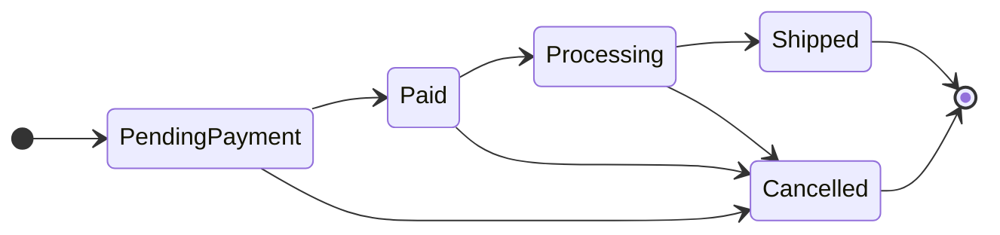
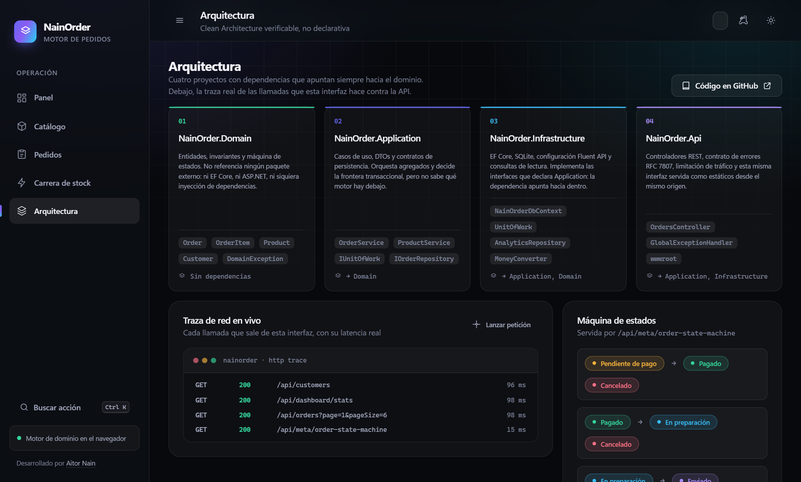

<picture>
  <source media="(prefers-color-scheme: dark)" srcset="docs/assets/banner-dark.svg">
  <source media="(prefers-color-scheme: light)" srcset="docs/assets/banner-light.svg">
  
</picture>

# NainOrder

**An order engine where a unit of stock can never be sold twice — and you can watch it prove it.**

[](https://github.com/Nain9Dev/NainOrder/actions/workflows/ci.yml)
[](https://github.com/Nain9Dev/NainOrder/actions/workflows/codeql.yml)


[](https://order.naindev.com/)

<p align="center">
  
</p>

> **Stock race** — 24 buyers hit 5 units at the same instant. Exactly 5 win, 19 get a `409`, and
> *sold + remaining = in stock* holds. Press the button in the panel and see it yourself.

---

## What it does

| 🛒 Orders | 📦 Inventory | 🔒 Guarantees |
| :--- | :--- | :--- |
| Basket → paid → processing → shipped, or cancelled | Adding a line **reserves** stock in the same transaction | No oversell under concurrency |
| Only legal transitions; the API publishes them | Cancelling **returns** every unit | Money in integer cents, never floats |
| Totals always equal the sum of the lines | Quantity changes adjust stock by the exact difference | Business failure `4xx`, technical failure `500` |



---

## Architecture

<p align="center">
  
</p>

The rule is **enforced, not declared**: `NetArchTest` fails the build if `Domain` references anything or
`Application` learns about EF Core.

<p align="center">
  
  
</p>

The client panel is plain ES modules served by the API itself: no npm, no build step, no CORS.

---

## Don't trust it, run it

| Claim | Proof |
| :--- | :--- |
| Stock is never oversold, even in a race | `StockRaceTests`, `ConcurrencyTests` |
| Stock never goes negative, for any sequence | `DomainInvariantProperties` (FsCheck) |
| Two writers on one order never lose an update | `OrderAggregateConcurrencyProbe` |
| Cancelling returns every unit | `OrderFlowTests` |
| Domain has zero dependencies | `CleanArchitectureTests` |
| The shipped container works | CI builds the image and probes it |

Every requirement maps to a test in [`docs/50-traceability.md`](docs/50-traceability.md).

---

## Quick start

```bash
git clone https://github.com/Nain9Dev/NainOrder.git
cd NainOrder/NainOrder.Api && dotnet run
```

Open <http://localhost:8170> — panel, [`/swagger`](http://localhost:8170/swagger) and `/health` are all there.
No database to install: SQLite creates itself.

```bash
dotnet test NainOrder.slnx -c Release          # 82 tests
docker build -t nainorder . && docker run -p 8080:8080 nainorder
```

> **About the live demo.** [order.naindev.com](https://order.naindev.com/) is a static page, so the panel runs
> on an in-browser engine and says so. The concurrency guarantees above run against the .NET API — locally.

---

## Go deeper

[Charter](docs/00-charter.md) · [Requirements](docs/10-requirements.md) · [Architecture](docs/20-architecture.md) ·
[Data model](docs/21-data-model.md) · [7 ADRs](docs/30-decisions/) · [Threat model](docs/22-threat-model.md) ·
[Traceability](docs/50-traceability.md) · [OpenAPI](docs/openapi.json)

**Stack** — C# 13 · .NET 10 · ASP.NET Core · EF Core · SQLite · xUnit · FsCheck · ES modules

---

*By [Aitor Nain](https://www.naindev.com/) — backend architect. Systems where data integrity is not negotiable.*
