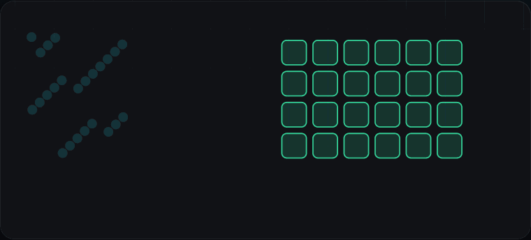
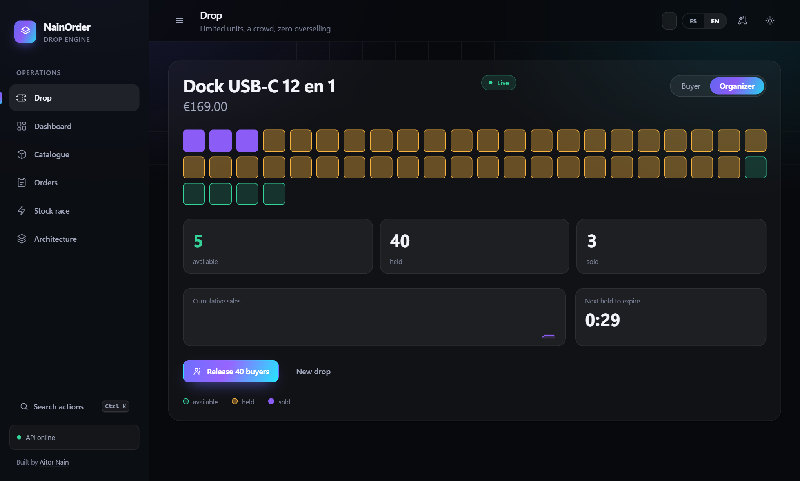
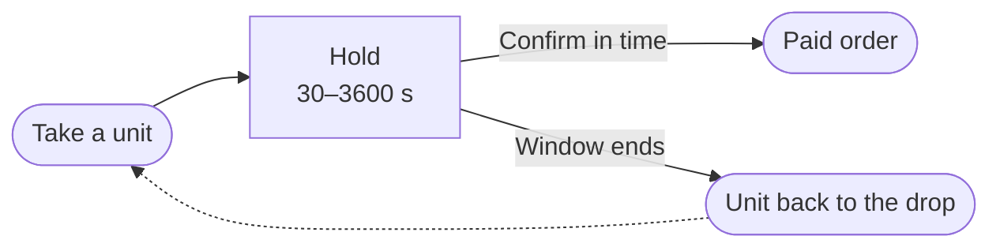
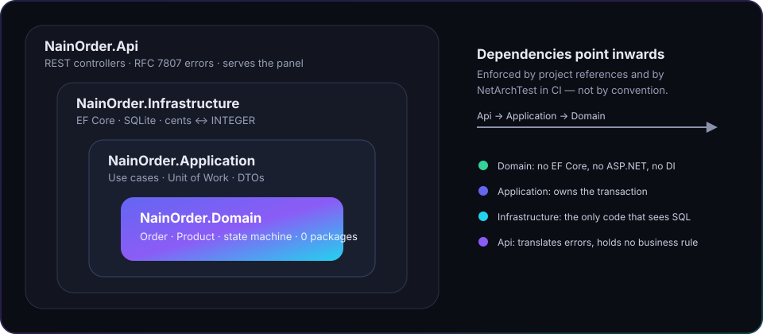
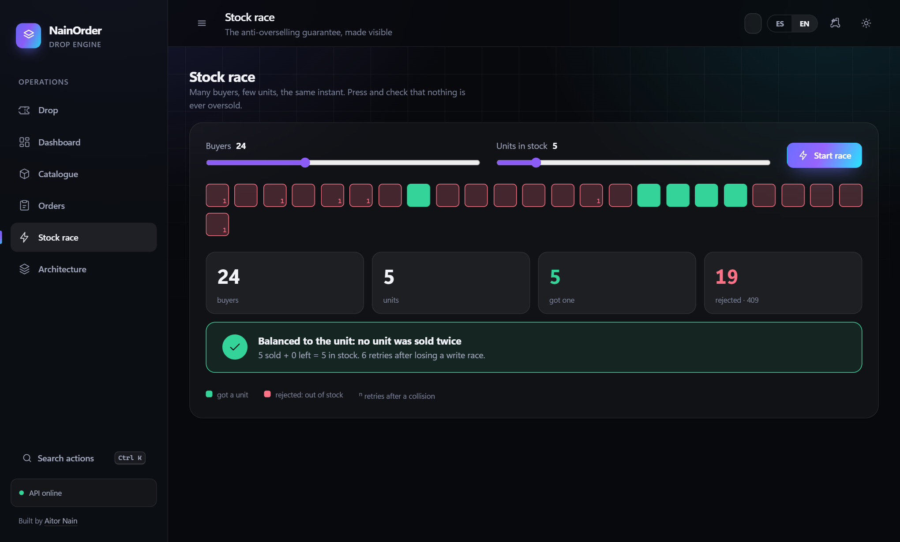
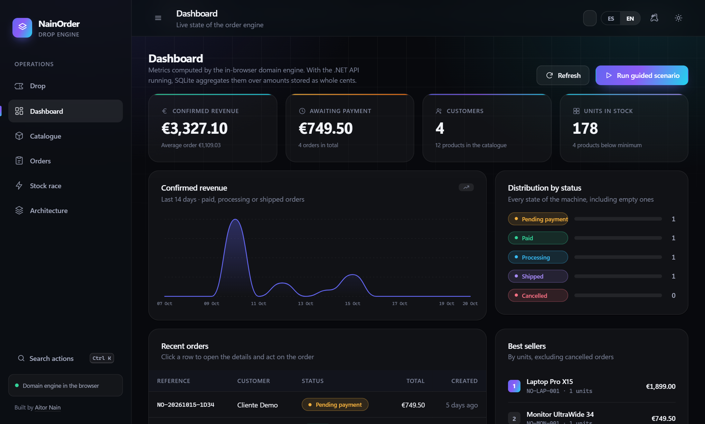

<picture>
  <source media="(prefers-color-scheme: dark)" srcset="docs/assets/banner-dark.svg">
  <source media="(prefers-color-scheme: light)" srcset="docs/assets/banner-light.svg">
  
</picture>

# NainOrder

**Sell a limited drop to a crowd — exactly N units, never oversold, no stock stuck in abandoned carts.**

[](https://github.com/Nain9Dev/NainOrder/actions/workflows/ci.yml)
[](https://github.com/Nain9Dev/NainOrder/actions/workflows/codeql.yml)


[](https://order.naindev.com/)

<p align="center">
  
</p>

<p align="center">
  
</p>

> **48 units. 40 buyers released at once.** Each unit is *available*, *held* for 30 seconds, or *sold*.
> Hold it and don't confirm: it goes back to the crowd. Try it as a **buyer** or an **organizer**, in
> Spanish or English: open the app and press **Release 40 buyers**.

---

## The problem it solves

Sneaker releases, merch drops and ticket sales fail the same way: a crowd arrives in one second, and
the shop either **oversells** or **locks stock behind abandoned carts**. NainOrder is the engine that
prevents both.



| Guarantee | How it is enforced |
| :--- | :--- |
| Never more units held + sold than the drop has | One aggregate, one concurrency token |
| A holder can't hog the drop | Per-buyer limit across holds and orders |
| Abandoned holds free themselves | Expiry applied on every read, swept every second |
| Money is exact | Integer cents, never floats |

---

## Architecture

<p align="center">
  
</p>

The rule is **enforced, not declared**: `NetArchTest` fails the build if `Domain` references anything or
`Application` learns about EF Core.

<p align="center">
  
  
</p>

The panel is plain ES modules served by the API itself: no npm, no build step, no CORS. It also ships a
**stock race** (many buyers, few units, one verdict) and the full order back office.

---

## Don't trust it, run it

| Claim | Proof |
| :--- | :--- |
| A crowd never holds or sells more than the drop contains | `DropFlowTests` (40 concurrent buyers), `DropTests` (property-based) |
| Holds expire without a sleeping test | `DropTests`, `DropFlowTests` with a hand-moved clock |
| Stock is never oversold, even in a race | `StockRaceTests`, `ConcurrencyTests` |
| Two writers on one order never lose an update | `OrderAggregateConcurrencyProbe` |
| Domain has zero dependencies | `CleanArchitectureTests` |
| The shipped container works | CI builds the image and probes it |

Every requirement maps to a test in [`docs/50-traceability.md`](docs/50-traceability.md).

---

## Quick start

```bash
git clone https://github.com/Nain9Dev/NainOrder.git
cd NainOrder/NainOrder.Api && dotnet run
```

Open <http://localhost:8170> → **Try as a buyer** or **Try as an organizer**. Also there: [`/swagger`](http://localhost:8170/swagger)
and `/health`. No database to install: SQLite creates itself.

```bash
dotnet test NainOrder.slnx -c Release          # 116 tests
docker build -t nainorder . && docker run -p 8080:8080 nainorder
```

> **About the live demo.** [order.naindev.com](https://order.naindev.com/) is a static page, so the panel runs
> on an in-browser engine and says so: one thread can't collide with itself. The concurrency guarantees
> run against the .NET API — locally.

---

## Go deeper

[Charter](docs/00-charter.md) · [Requirements](docs/10-requirements.md) · [Architecture](docs/20-architecture.md) ·
[Data model](docs/21-data-model.md) · [9 ADRs](docs/30-decisions/) · [Threat model](docs/22-threat-model.md) ·
[Traceability](docs/50-traceability.md) · [OpenAPI](docs/openapi.json) · [Drops spec](specs/002-drops/spec.md)

**Stack** — C# 13 · .NET 10 · ASP.NET Core · EF Core · SQLite (WAL) · xUnit · FsCheck · ES modules

---

*By [Aitor Nain](https://www.naindev.com/) — backend architect. Systems where data integrity is not negotiable.*
