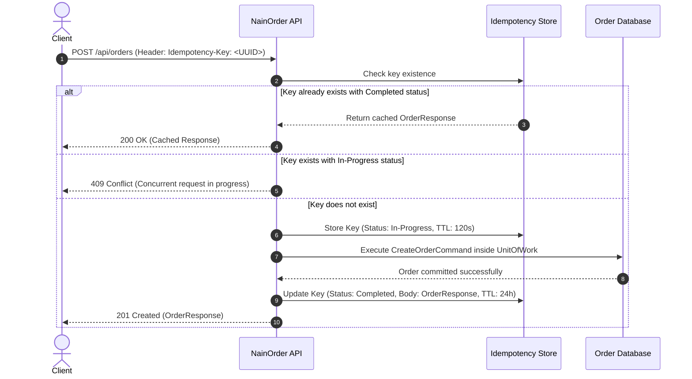

# Threat Model & Security Posture (STRIDE)

> Formal security architecture, trust boundary analysis, and threat mitigations for the NainOrder E-Commerce API.

---

## 1. Trust Boundaries & Data Flow Diagram

```mermaid
flowchart LR
    subgraph untrusted["Untrusted Public Network"]
        Client["Browser Client / Third-Party Consumer"]
    end

    subgraph edge["Edge & Network Boundary"]
        ReverseProxy["Cloudflare Edge / Reverse Proxy<br/><i>TLS Termination, DDoS Shield</i>"]
    end

    subgraph app_boundary["Application Trust Boundary (NainOrder.Api)"]
        RateLimiter["Rate Limiter & CORS Policy"]
        AuthFilter["Authentication & Authorization Filter"]
        Validator["Input Validation Gate<br/><i>FluentValidation</i>"]
        OrderController["OrdersController & State Machine"]
    end

    subgraph data_boundary["Data Storage Boundary"]
        UoW["Unit of Work & DbContext"]
        Database[("PostgreSQL / SQLite Storage")]
    end

    Client -->|HTTPS / REST| ReverseProxy
    ReverseProxy -->|Validated TLS| RateLimiter
    RateLimiter --> AuthFilter
    AuthFilter --> Validator
    Validator --> OrderController
    OrderController --> UoW
    UoW --> Database
```

---

## 2. STRIDE Threat Matrix & Mitigations

| Threat Category | Potential Threat Vector | Impact | Mitigation Strategy & Invariants |
| :--- | :--- | :--- | :--- |
| **Spoofing Identity** | Attacker impersonates an authorized customer or administrator to place or cancel orders. | High | Cryptographically signed JWT tokens with claims-based authorization. Customer ID derived strictly from validated identity claims, never trusted from client-provided JSON payloads. |
| **Tampering with Data** | Attacker tampers with monetary amounts, product prices, or quantities in order payload. | Critical | **Integer Cents Representation (ADR-0001)**: Monetary calculations executed strictly in 64-bit integer cents. Client-submitted prices are rejected; prices are resolved server-side from authoritative product aggregates. Optimistic concurrency tokens prevent concurrent modification. |
| **Repudiation** | Customer disputes having placed an order or claims a different quantity was submitted. | Medium | All order placement commands generate structured audit events with UTC timestamp, W3C Traceparent, client IP hash, and immutable initial snapshot stored in the database. |
| **Information Disclosure** | API error stack traces leak internal database connection strings, schema details, or server paths. | High | **RFC 7807 ProblemDetails Error Contract (ADR-0005)**: Unhandled exceptions are intercepted by `GlobalExceptionHandler`. Clients receive standardized ProblemDetails payloads with opaque correlation IDs. Stack traces are never transmitted to clients. |
| **Denial of Service** | Volumetric payload floods, repeated checkout attempts, or connection pool exhaustion. | High | Fixed payload size limits (128 KB max for order payloads), sliding window rate limiting (100 req/min per IP), and deterministic query timeouts (5.0s max) preventing long-lived transaction blocking. |
| **Elevation of Privilege** | Standard customer accesses internal admin analytics or order cancellation endpoints. | Critical | Controller-level role-based authorization attributes (`[Authorize(Roles = "Admin")]`). Query filters enforce that customers can only project orders where `CustomerId == CurrentUser.Id`. |

---

## 3. Idempotency Specification (`Idempotency-Key`)

To eliminate duplicate charges and ghost orders caused by network retries or double-clicking, the order submission endpoint enforces an idempotency invariant:

### Idempotency Contract Rules
1. **Header Name**: `Idempotency-Key` (RFC draft standard). Value must be a valid UUID v4.
2. **Deterministic Payload Matching**: If the same `Idempotency-Key` is received with a differing request body hash, the server immediately returns `422 Unprocessable Entity` (`IdempotencyPayloadMismatch`).
3. **Retention**: Completed idempotency entries persist for 24 hours.

---

## 4. Concurrency & Race Condition Defense

- **Stock Reservation Concurrency (ADR-0002)**: Inventory decrement utilizes optimistic concurrency checks (`xmin` / `version` field). If stock is depleted between item selection and checkout, the transaction aborts with `409 Conflict` (`InsufficientStock`), preventing overselling.
- **Order Aggregate Concurrency (ADR-0007)**: Cancellation and status transitions evaluate aggregate version tokens to guarantee that an order cannot be simultaneously cancelled and dispatched.
