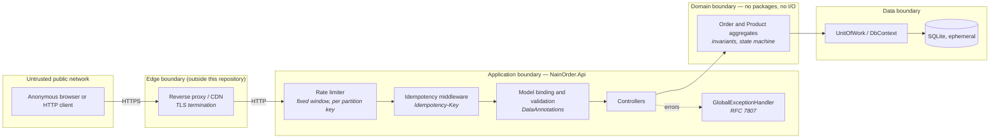
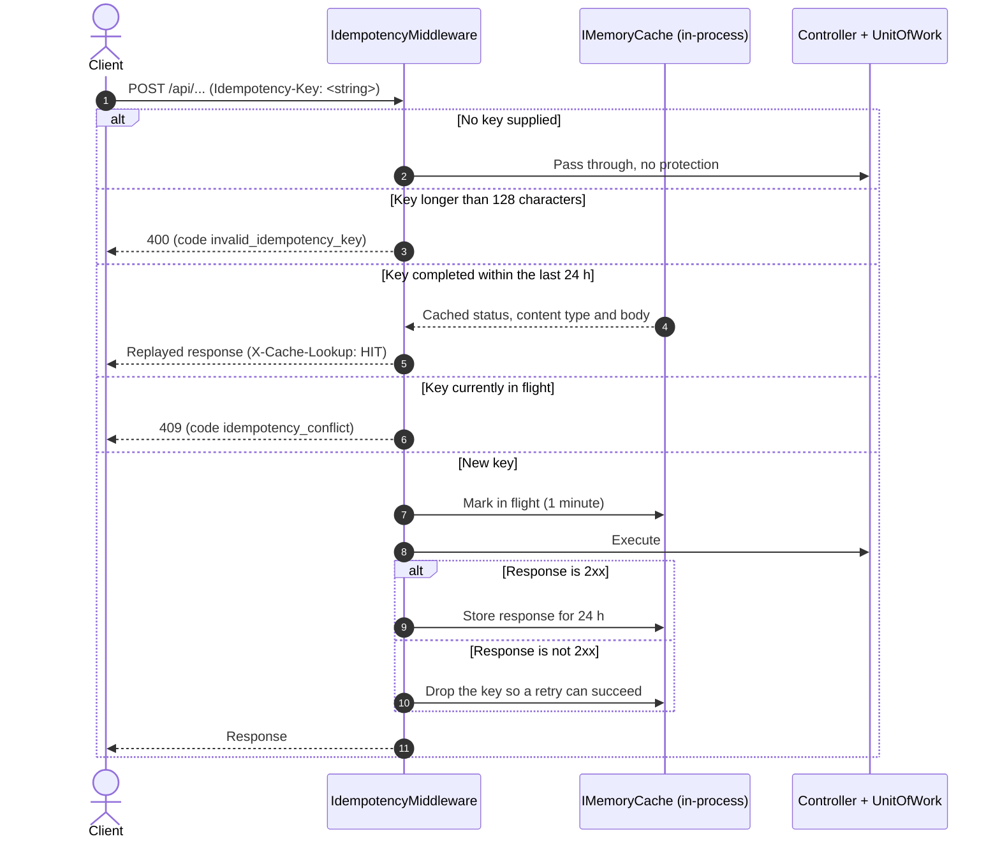

# Threat model and security posture (STRIDE)

**Status:** Active · verified against the code at the commit that carries this file.

This document models **the system that exists**: a public, unauthenticated demonstration of an
order engine, served as a single container with SQLite on ephemeral storage. Every mitigation
listed below names the file that implements it, so a reader can check the claim instead of
trusting it. Everything the system does *not* do is in §2, not omitted.

A control that is not in the code does not belong in this document, however good an idea it is.
Candidate controls live in §7 as explicit gaps.

---

## 1. System under analysis

| Property | Reality |
| :--- | :--- |
| Audience | Public internet, anonymous |
| Authentication | **None.** A deliberate non-goal — see [`00-charter.md`](00-charter.md) |
| Authorisation | **None.** Every caller can perform every operation |
| Persistence | SQLite file, ephemeral container storage, reseeded on start-up |
| Data held | Synthetic catalogue and synthetic customers. No real personal data, no payment data, no secrets |
| Deployment | One container, non-root user, TLS terminated by a reverse proxy in front |
| Client | Static panel served from the same origin (`NainOrder.Api/wwwroot`) |

### Trust boundaries

The security-relevant boundary is **Controller → Domain**: nothing that crosses it may violate an
invariant, regardless of what the caller sends. That is the property the test suite exercises, and
it is the one this deployment actually defends.

---

## 2. Out of scope, and why

Naming these is part of the model. Each is a decision recorded in
[`00-charter.md`](00-charter.md), not an oversight:

| Not modelled | Why | Consequence accepted |
| :--- | :--- | :--- |
| Authentication and authorisation | The deployment is a public demonstration; accounts would obscure the domain, which is the subject | **Anyone can read, create, modify and cancel any order.** There is no confidentiality claim of any kind |
| Payment processing | `MarkAsPaid` is a domain transition; a real processor adds an external dependency, not a domain rule | No card data exists, so no card data can leak |
| Multi-tenancy | Single global catalogue | No tenant isolation to breach |
| Durable storage | Ephemeral container storage, reseeded on start | **Data loss on redeploy is expected behaviour**, not an availability incident |
| Audit trail / event sourcing | Per-transition timestamps are kept; the full trail is not modelled | Repudiation is only partially addressed — see §3 |

**Everything written to this system is public and disposable.** That sentence is the security
model, and it is why the risks below are rated against a demonstration, not against a system of
record.

---

## 3. STRIDE analysis

| Category | Threat | Real exposure | What actually mitigates it |
| :--- | :--- | :--- | :--- |
| **Spoofing** | A caller acts as another customer | **Not mitigated. Fully exposed by design.** There is no identity to spoof because there is no identity | Accepted: no authentication is a charter non-goal. Nothing in the data is real |
| **Tampering** | Client submits its own prices or totals to pay less | **Mitigated.** `OrderService.AddItemToOrderAsync` resolves the unit price from the `Product` aggregate; the request body carries only `productId` and `quantity`. Totals are recomputed by the aggregate, never accepted from the client | `Order.AddItem`, `Money` value object, ADR-0001 (integer cents). Covered by `DomainInvariantProperties.The_order_total_always_equals_the_sum_of_its_lines` |
| **Tampering** | Concurrent writers corrupt stock or order totals | **Mitigated.** Version tokens (`IsConcurrencyToken`) on both `Product` and `Order`; conflicting writers lose the `UPDATE` and receive `409` | ADR-0002, ADR-0007. Covered by `ConcurrencyTests` and `OrderAggregateConcurrencyProbe` |
| **Tampering** | Replayed or double-submitted mutation creates duplicates | **Partially mitigated.** `IdempotencyMiddleware` caches the response for a given `Idempotency-Key` for 24 h and rejects a concurrent in-flight duplicate with `409`. **The key is optional**, so a client that omits it gets no protection, and the store is in-process (§7) | `NainOrder.Api/Infrastructure/IdempotencyMiddleware.cs`, covered by `IdempotencyTests` |
| **Repudiation** | A caller denies having placed an order | **Not mitigated.** No identity, no audit log, no signed receipt. Only per-transition UTC timestamps on the aggregate | Accepted: out of scope per charter. Would require authentication first |
| **Information disclosure** | An unhandled exception leaks stack traces, paths or the connection string | **Mitigated.** A single `IExceptionHandler` translates every exception into RFC 7807. Outside Development, the `500` body carries a stable `code` and a `traceId`, never the exception message | ADR-0005, `GlobalExceptionHandler.cs`. Covered by `GlobalExceptionHandlerTests` asserting suppression outside Development |
| **Information disclosure** | An unknown `/api` route returns the panel's HTML, confusing a JSON client | **Mitigated.** `MapFallback` on `/api` and `/swagger` returns RFC 7807 `404` | `Program.cs`. Covered by `An_unknown_api_route_returns_json_404_and_never_the_client_application` and by the container smoke test in CI |
| **Information disclosure** | Response headers leak framework or infrastructure detail | **Partially mitigated.** No security headers are emitted (§7) | — |
| **Denial of service** | Request flood exhausts the free-tier instance | **Weakly mitigated.** Fixed-window limiter, 120 requests per minute, partitioned by remote IP. **The partition key is spoofable** — see §7, G-1 | `Program.cs`, `RateLimitPolicies.Api` |
| **Denial of service** | Oversized body or long-running query ties up the process | **Not mitigated.** No explicit request body size limit beyond the Kestrel default, and no EF Core command timeout is configured (§7) | — |
| **Elevation of privilege** | A caller reaches an operation it should not have | **Not applicable.** There are no privilege levels: every operation is public by design | Accepted, as above |
| **Elevation of privilege** | Code execution inside the container reaches the host | **Mitigated.** The container runs as a non-root user with write access limited to `/app/data` | `Dockerfile`. Covered by the CI smoke test asserting `id -u != 0` |
| **Elevation of privilege** | Injected markup in the panel executes as script | **Mitigated by default, with a caveat.** The `html` template escapes every interpolated value, and all data from the API passes through it. The caveat is the `raw()` escape hatch — see §7, G-4 | `wwwroot/assets/js/dom.js` |
| **Supply chain** | A vulnerable dependency ships | **Mitigated.** CI fails on `dotnet list package --vulnerable` over the JSON output, including transitives. Central Package Management pins every version | `.github/workflows/ci.yml`, `Directory.Packages.props` |
| **Supply chain** | A third-party script compromises the panel | **Not mitigated.** The panel loads two remote resources without Subresource Integrity — see §7, G-3 | — |

---

## 4. Idempotency, as implemented

The middleware applies to **every** `POST`, `PUT` and `PATCH`, not only to order creation.

**Contract, as the code enforces it:**

1. Header `Idempotency-Key`, or `X-Idempotency-Key`. Maximum 128 characters.
   **Any string is accepted** — no UUID format is required or validated.
2. The key is **optional**. A client that omits it receives no replay protection.
3. Only `2xx` responses are cached, for 24 hours. A failure drops the key so a retry can proceed.
4. An in-flight key is locked for 1 minute and duplicates receive `409`.
5. **The request body is not hashed.** The same key reused with a different body replays the
   first response instead of rejecting the mismatch. See §7, G-2.

---

## 5. Concurrency defence

- **Stock (ADR-0002).** `Product.Version` is declared `IsConcurrencyToken()`. Two requests racing
  for the last unit cannot both win: the loser's `UPDATE` affects zero rows and surfaces as `409`.
  `Product.RemoveStock` additionally refuses to go negative at the domain level, so the invariant
  holds even without the database check.
- **Order aggregate (ADR-0007).** `Order.Version` is likewise a concurrency token, so two
  simultaneous basket mutations cannot produce a lost update or desynchronise the materialised
  totals.
- Both are enforced as an `int` version column. There is no PostgreSQL `xmin`; the engine is SQLite.

---

## 6. Data protection

- The seeded catalogue and customers are **synthetic**. No real personal data is stored.
- The system holds **no credentials, API keys or payment data**. There is nothing to rotate and
  nothing to leak. `gitleaks` over the full history reports no findings.
- The client panel persists UI state and, in static demonstration mode, its in-memory database to
  `localStorage` under the `nainorder.*` prefix. This is strictly functional storage, local to the
  visitor's browser, and is never transmitted to the server.
- The panel currently loads two resources from `naindev.com`, which transmits the visitor's IP
  address, user agent and referrer to a third origin. See §7, G-3. There is no privacy notice in
  the repository yet (G-6).

---

## 7. Known gaps

Open and tracked, not mitigated. Listing them is the point of the document.

| ID | Gap | Impact | Severity |
| :--- | :--- | :--- | :--- |
| **G-1** | `ForwardedHeadersOptions` clears `KnownProxies` and `KnownIPNetworks`, so `X-Forwarded-For` is trusted from any source. The rate limiter partitions on the resulting IP, so **rotating that header bypasses the 120 req/min limit** | The only DoS control is defeatable by any caller | High |
| **G-2** | The idempotency middleware does not hash the request body, so the same key with a different payload replays the first response rather than rejecting it | A client reusing a key by mistake silently receives the wrong resource | Medium |
| **G-3** | `index.html` loads `brand.naindev.com/tokens.css` and `www.naindev.com/assets/js/ecosystem-bar.js` with no Subresource Integrity. The latter patches `window.fetch` globally | A compromise of either origin executes arbitrary code in the panel. Also contradicts the zero-dependency constraint of ADR-0006 | High |
| **G-4** | `dom.js` exposes `raw()` to compose templates, used in 83 places, each one bypassing the default escaping. `views/architecture.js` interpolates into a plain template literal inside `raw()` | No live injection today (the data there is static), but the escaping guarantee is weaker than it reads | Medium |
| **G-5** | No security response headers: no CSP, `X-Content-Type-Options`, `Referrer-Policy`, `X-Frame-Options`, `Permissions-Policy` or HSTS | The panel can be framed; a CSP would also contain G-3 and G-4 | Medium |
| **G-6** | No privacy notice anywhere, although G-3 causes visitor IP addresses to reach a third origin | Information duty unmet under GDPR art. 13 | Medium |
| **G-7** | The idempotency store is `IMemoryCache`: per-process and lost on restart | Replay protection does not survive a redeploy and would not hold across instances | Low, given single-instance deployment |
| **G-8** | No request body size limit and no EF Core command timeout | A large body or a slow query holds a connection longer than intended | Low |
| **G-9** | `main` has no branch protection, so a red pipeline does not block a push | The stated quality gate is advisory, not enforced | Medium |
| **G-10** | GitHub Actions are referenced by mutable tags rather than pinned by commit SHA | A compromised or retagged action runs with the workflow's permissions | Medium |

---

## 8. What a reader should conclude

This deployment defends **integrity**, not confidentiality. The claim it makes is narrow and
testable: whatever sequence or concurrency of requests arrives, stock cannot go negative, an order
cannot reach a forbidden state, a total always equals the sum of its lines, and a business failure
is never reported as a technical one. Those properties have tests; see
[`50-traceability.md`](50-traceability.md).

It makes **no confidentiality or availability claim whatsoever**, because it has no users, no
secrets and no durable data. Reading it as a production-ready system would be a misreading, and
§2 and §7 exist so that misreading is not possible.
