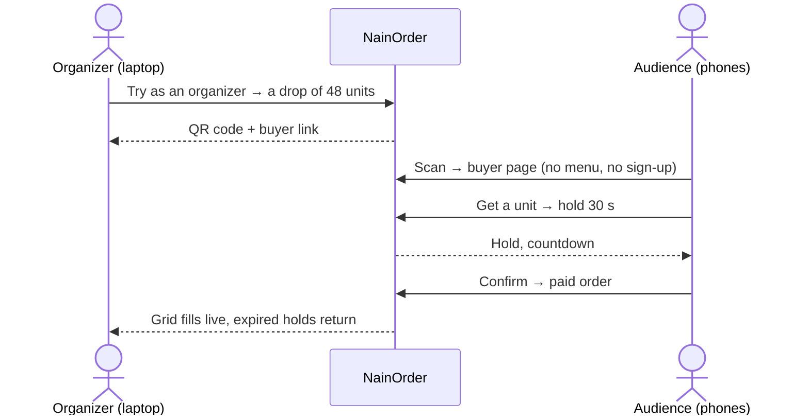

# Use case — a limited release at a pop-up

**Who it is for:** a small brand selling a limited run (sneakers, merch, tickets) to a crowd it can
see — a pop-up, a launch party, a livestream — and that cannot afford to oversell or to leave stock
stuck in abandoned carts.

  
  

## Run it in five minutes

| Step | What you do | What you get |
| :--- | :--- | :--- |
| 1 | `dotnet run --urls http://0.0.0.0:8170` in `NainOrder.Api` | The API and the panel, reachable from the local network |
| 2 | Open `http://<your-computer-IP>:8170` on the laptop | The panel; the QR code now encodes an address phones can reach |
| 3 | **Try as an organizer** | A 48-unit drop, 4 per person, 30-second holds |
| 4 | Show the QR code; the audience scans it | Each phone lands on the buyer page, nothing to install |
| 5 | Watch the grid | Units go *held* then *sold*; a hold nobody confirms returns to the crowd |

To install the panel as an app, serve it over HTTPS (a reverse proxy or a tunnel); browsers only
offer installation on a secure origin. On plain HTTP over the local network the buyer page works,
it just cannot be installed.

## What the seller gets, and what proves it

| The seller's problem | What NainOrder does | Proof |
| :--- | :--- | :--- |
| "We sold more than we had" | Held plus sold never exceeds the drop's units, under any concurrency | `DropFlowTests` (40 simultaneous buyers), `DropTests` (property-based) |
| "Stock is stuck in carts nobody pays" | A hold expires and its unit returns; the clock is applied on every read | `DropFlowTests` with a hand-moved clock |
| "One buyer took everything" | A per-buyer limit across holds and orders | `DropTests` |
| "Buyers must install or sign up" | A link and a QR code; an anonymous token identifies the visitor | `PwaAssetsTests`, manual phone check |
| "The Wi-Fi dropped" | The panel opens from its cache and says it is offline; it never invents units | `PwaAssetsTests`, manual offline check |

## What it does not do (on purpose)

- **No real payment.** Confirming a hold marks the order as paid; plugging a payment provider in is
  a separate decision (see [Q-006](11-open-questions.md)).
- **No accounts.** Buyers are anonymous visitors, limited per browser token and per address.
- **One instance.** A single SQLite database; a high-volume launch needs a different engine, which
  is a `UseSqlite` change, not a domain change ([runbook](60-runbook.md)).

No customer figures appear here because there is no customer yet: this repository proves the
guarantees above with tests, and the scenario is reproducible with the five steps.
